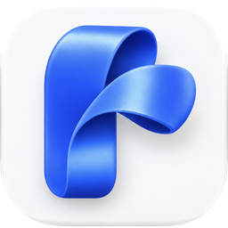
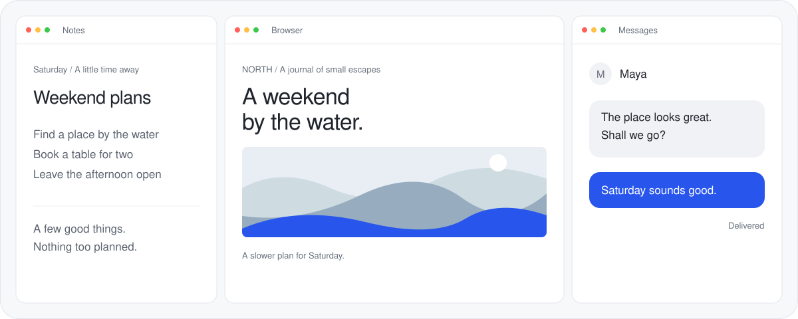

<p align="center">
  
</p>

<h1 align="center">Ribbon</h1>

<p align="center">Your windows, side by side.</p>
<p align="center">A native scrolling window manager for your Mac.</p>

<p align="center">
  <a href="https://github.com/BlockchainHB/Ribbon/releases/download/v0.2.0-beta.1/Ribbon-macOS-arm64.zip">Download for Mac</a>
  &nbsp;·&nbsp;
  <a href="docs/GETTING_STARTED.md">Getting started</a>
  &nbsp;·&nbsp;
  <a href="https://github.com/BlockchainHB/Ribbon/releases">Release notes</a>
</p>



Ribbon keeps your windows in a horizontal strip. Move through them with the keyboard, choose the widths that suit your work, and keep two apps together when they belong together.

- **Pair your apps.** Keep notes beside a browser. Move the pair together, or use a ⅓–⅔ arrangement without linking the windows.
- **See and arrange.** Open an overview of your windows. Drag an icon to reorder, or click to focus a hidden tile.
- **Use every display.** Keep an independent strip on each screen and move columns between displays.

Native sidebar settings, customizable shortcuts, vertical stacks, and a menu bar control keep everything close at hand. Normal app windows join automatically; exclusions let you leave apps alone.

## Get started

Requires **macOS 15 or later** and **Apple silicon**. The first public release is a beta.

1. [Download Ribbon](https://github.com/BlockchainHB/Ribbon/releases/download/v0.2.0-beta.1/Ribbon-macOS-arm64.zip), unzip it, and move **Ribbon.app** to **Applications**.
2. Allow **Ribbon** in **System Settings → Privacy & Security → Accessibility**.
3. Open **Ribbon → Settings → General** and turn on **Window management**.

Ribbon starts paused. Pause it again from the menu bar to restore your window positions. No account or subscription is required.

## At your fingertips

| Action | Shortcut |
| --- | --- |
| Focus a neighboring column | `⌃ ⌥ ← / →` |
| Reorder a column | `⌃ ⌥ ⇧ ← / →` |
| Arrange windows | `⌃ ⌥ Tab` |
| Cycle widths | `⌃ ⌥ R` |
| Toggle full width | `⌃ ⌥ F` |
| Stack / unstack | `⌃ ⌥ ]` / `⌃ ⌥ ⇧ ]` |
| Move to the next display | `⌃ ⌥ N` |
| Pause and restore | `⌃ ⌥ Q` |

All assignments can be changed in **Settings → Shortcuts**. Pairing is available from the overview's context menu; its shortcuts are yours to assign. [Read the guide →](docs/GETTING_STARTED.md)

## Early release notes

Some apps enforce minimum window sizes. macOS can retain a small edge of an offscreen window. Pair membership lasts for the current session. Multi-display pairing, mixed-scale transfers, sleep/wake, and display reconnects need more physical testing. Intel builds and automatic updates are not included.

The app keeps settings and recovery data locally. It does not persist document titles or window contents, and uses no accounts or telemetry. Avoid running another window manager alongside Ribbon.

Found something? [Open an issue](https://github.com/BlockchainHB/Ribbon/issues) with your macOS version, display arrangement, and steps to reproduce. Keep private document contents out of screenshots.

<details>
<summary><strong>Build from source</strong></summary>

Requires Apple silicon, Xcode 26 or later with Icon Composer support, Python 3, and Rust 1.95.0. Dependencies and the engine source are pinned.

```sh
git clone https://github.com/BlockchainHB/Ribbon.git
cd Ribbon
scripts/build-app.sh
scripts/install.sh
```

Local builds use an installed Developer ID identity when available and otherwise fall back to ad-hoc signing. Only the published release goes through notarization.

```sh
scripts/verify.sh
```

SwiftUI and AppKit own configuration and engine lifecycle. The Rust engine owns window layout, focus, and gestures. It is based on a checked-in Paneru snapshot; local changes are documented in [vendor/paneru/RIBBON.md](vendor/paneru/RIBBON.md).

[Development notes](docs/DEVELOPMENT.md) · [Release process](docs/RELEASING.md) · [Website](website/README.md)

</details>

## Built on good work

Ribbon's engine builds on [Paneru](https://github.com/karinushka/paneru) by Karinushka. Its MIT license and upstream notices are preserved, and dependency notices ship with the app.

[MIT license](LICENSE). Apple application icons in website illustrations belong to Apple.
